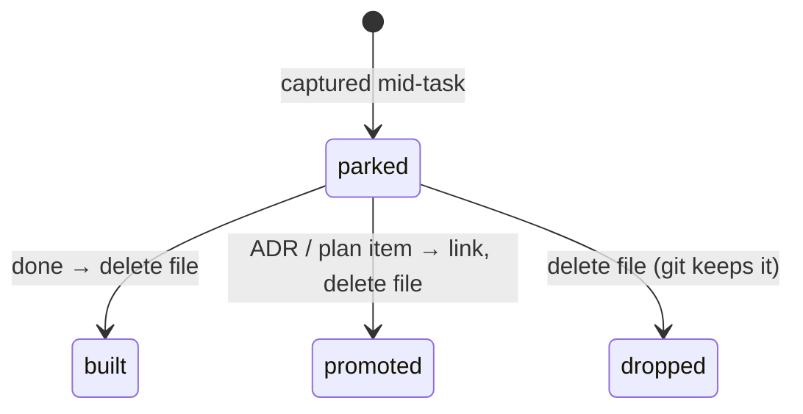

An idea that comes up mid-task goes into `docs/ideas/YYYY-MM-DD-slug.md` and the task goes on.

## Why

| without it | failure |
|---|---|
| idea acted on at once | task derailed; half-built tangent in the diff |
| idea left in chat | gone with the session |
| idea as a TODO in code or docs | scattered, unfindable, rots in place |

## Shape

```markdown
# produce publishes, then hands off

> yeah lets set it up so that if it aint totally bad, it goes to youtube...

Context: waiting on an unattended `produce` run; the session cache expired meanwhile.

- optional: first thoughts on shape, flags, risks
```

- The idea **in the words it came in**, quoted. Paraphrase loses intent.
- One line of context: what we were doing when it came up.
- Small: one idea per file.

## Lifecycle



A file in `ideas/` means *not yet addressed*. The directory is the open list.

## Boundaries

| | idea | [papercut](../principles/papercuts.md) | [ADR](../principles/adr.md) |
|---|---|---|---|
| trigger | "we could…" | "this hurt" | a choice between real alternatives |
| when resolved | deleted | `status: fixed`, kept | never deleted; superseded |

[Session handoff](session-handoff.md) links new ideas from `next-session.md`
so the next session sees them.

## Open

- Delete vs keep with a status: papercuts keep fixed ones, ideas delete. Pick one rule for both?
- Should ideas carry tags, so "before a task, read docs touching the area" finds them?
