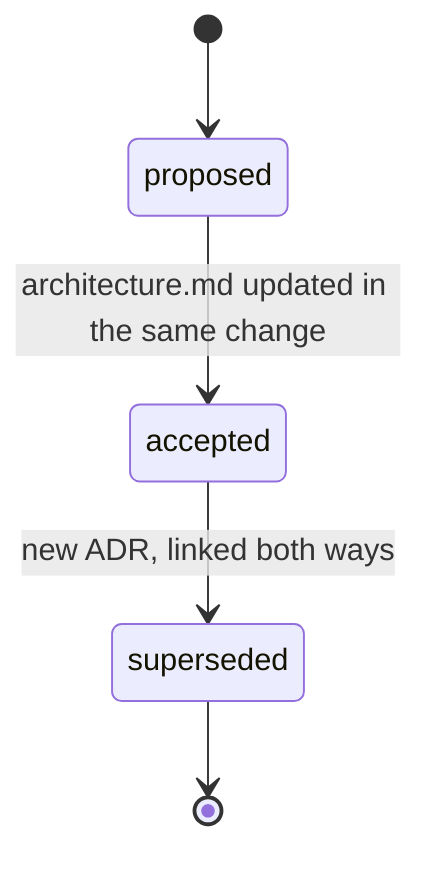

`docs/adr/NNNN-slug.md` records each change from the [architecture](architecture.md) baseline onward:
what was decided, why, and what was rejected.

## Why

| without ADRs | failure |
|---|---|
| the why lives in a chat or a PR thread | agent "simplifies" away a deliberate constraint |
| rejected alternatives unrecorded | same option proposed and evaluated again |
| decisions edited after the fact | no record of what was believed when |

## When to write one

- Choosing between real alternatives.
- Adding a dependency.
- Changing a public interface or a data shape.

Not for past decisions: **no backfilled ADRs**. The baseline `architecture.md` covers the state before them.

## Lifecycle



- **Accepting** an ADR means updating [`architecture.md`](architecture.md) in the same change.
- **Never rewrite** an accepted ADR. Supersede it with a new one and link both ways
  (`supersedes` / `superseded_by`).

## Shape

Template: [`scaffold/docs/adr/0000-template.md`](../../scaffold/docs/adr/0000-template.md).

```yaml
---
title: "0007: round at invoice level, not line level"
tags: [billing]
code: [src/pkg/billing.py::compute_invoice]
status: accepted   # proposed | accepted | superseded
supersedes:        # adr/NNNN-....md
superseded_by:
---
```

| section | answers |
|---|---|
| Context | what forced a decision, under which constraints |
| Decision | what we do |
| Consequences | what gets easier, harder, must stay true; which `architecture.md` section reflects it |
| Alternatives | table: option, why not |

Naming: zero-padded sequence + slug, `0007-invoice-rounding.md`. `0000` is the template.

## Interplay

| rule | link |
|---|---|
| [architecture](architecture.md) | current state; ADRs are the diffs that got it there |
| [freshness](freshness.md) | `code:` on the ADR points at what it governs |
| [QA](qa.md) | a diff vs main can cite the ADR that explains it, e.g. `explained: rounding fix (adr/0007)` |
| [knowledge](knowledge.md) | tags from `docs/tags.md`; one decision per file |

## Tooling

| check | command |
|---|---|
| accepted ADR ⇒ `architecture.md` touched in the same commit | `check` |
| frontmatter present, tags in vocabulary, links resolve | `check` |
