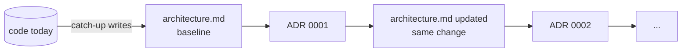

`docs/architecture.md` describes the system as it is *now*. One file, kept true. No history in it.

## Why

| without it | failure |
|---|---|
| agent reconstructs structure from code every session | context burned; wrong guesses about boundaries |
| history mixed into current state | reader can't tell what still holds |
| decisions scattered in PRs and chats | same trade-off re-litigated; invariants broken unknowingly |

## What goes in

| section | content | form |
|---|---|---|
| purpose | one line | sentence |
| flow | components and data flow | mermaid `flowchart` |
| components | name, code path, what it owns, what it talks to | table |
| key data shapes | contracts between components | schema blocks, or links to them |
| invariants | what must stay true | list |
| decisions | link to [ADRs](adr.md) | link |

Template: [`scaffold/docs/architecture.md`](../../scaffold/docs/architecture.md).

```yaml
---
title: Architecture
tags: [architecture]
code: [src/]
---
```

## What stays out

- History, dates, "recently", "we used to". Git has the history; [ADRs](adr.md) have the why.
- Intent you can't verify in the code.
- Paraphrased code. Point at it with `code:` (see [freshness](freshness.md)).
- TODOs. Log a [papercut](papercuts.md).

## Baseline, then ADRs



- **Missing `architecture.md`:** write it from the code as the baseline. Describe only what you can verify.
- **No backfilled ADRs.** Past decisions are not reconstructed; ADRs start from the baseline.
- **Accepting an ADR means updating `architecture.md` in the same change.** The ADR says which section.

## Size

One concept per file, ~<150 lines ([small files](knowledge.md)).
A large repo's `architecture.md` will outgrow that and should become an index plus per-component files.
How exactly is **open**: it gets written as an ADR once it actually happens.

## Interplay

| rule | link |
|---|---|
| [ADRs](adr.md) | each accepted ADR edits this file in the same change |
| [freshness](freshness.md) | `code:` lists the paths it describes; moving them means updating it |
| [QA](qa.md) | invariants here are candidates for oracles in `QA.md` |
| [papercuts](papercuts.md) | a doc that misled you is a papercut |

## Tooling

| check | command |
|---|---|
| `code:` refs resolve (path + symbol) | `check` |
| accepted ADR ⇒ `architecture.md` touched in the same commit | `check` |
| docs covering the changed paths | `touching <paths>` |
