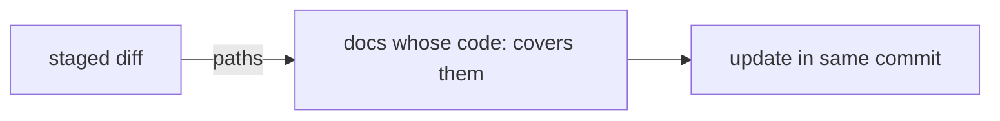

Docs point at code via frontmatter `code:`, never the reverse.
Change or move anything a doc's `code:` lists → update that doc in the same commit.

## Why

| without it | failure |
|---|---|
| no link from doc to code | nobody knows which docs a change invalidates |
| links from code to docs | comments rot silently; two directions to keep in sync |
| "update docs later" | a stale doc is worse than none: agents trust it |

## Shape

```yaml
code: [src/pkg/billing.py::compute_invoice, src/pkg/io/]
```

| form | meaning |
|---|---|
| `path/to/file.py` | the whole file |
| `path/to/dir/` | everything under it |
| `path/to/file.py::Symbol` | one definition in that file |

One direction, checkable: a tool can resolve every ref, and can find docs from a changed path.

## Rule

1. **Before a task:** find docs whose `tags`/`code` touch the area. Read them and their open [papercuts](papercuts.md).
2. **During:** change or move anything in some doc's `code:` → update that doc, same commit.
3. **Don't paraphrase code.** `code:` points at it; the doc adds only what code can't say: why, invariants, gotchas.



## Same rule elsewhere

| artifact | fresh means |
|---|---|
| docs | `code:` targets exist; text true for them |
| [`architecture.md`](architecture.md) | updated with each accepted [ADR](adr.md) |
| [`QA.md`](qa.md) `expect` | baseline moved on purpose → `expect` updated in the same commit |
| rules section in `AGENTS.md` | version marker on line 1; [catch-up](../catch-up.md) upgrades older versions |

## Interplay

| rule | link |
|---|---|
| [knowledge](knowledge.md) | frontmatter is where `code:` lives |
| [style](../../scaffold/docs/style.md) | no dates or "recently" in current-state docs |
| [catch-up](../catch-up.md) | adds only `code:` refs verified to exist |

## Tooling

| check | command | priority |
|---|---|---|
| `code:` refs resolve (path + symbol) | `check` | 1 |
| docs whose `code:` covers given paths, for the staged diff in a commit hook | `touching <paths>` | 2 |
