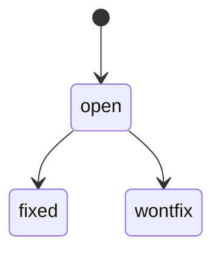

`docs/papercuts/slug.md`: anything that slowed the agent or the human down. Logged at the moment it hurts.

## Why

| without a log | failure |
|---|---|
| friction forgotten after the session | every session pays the same cost again |
| agent works around a broken step silently | the workaround becomes invisible tribal knowledge |
| fixes done inline mid-task | scope creep; the actual task gets a muddy diff |

## What counts

- A confusing error message.
- A flaky step or test.
- A missing script; a command you had to reconstruct.
- A misleading doc.
- A `QA.md` tier command that doesn't match CI ([QA](qa.md)).
- A tier that fails or can't run during catch-up.

## Rule

1. Log it when you hit it.
2. Fix inline only if trivial. Otherwise the papercut is the deliverable.
3. Before a task, read the open papercuts for docs whose `tags`/`code` touch the area.

## Shape

Template: [`scaffold/docs/papercuts/_template.md`](../../scaffold/docs/papercuts/_template.md).

```yaml
---
title: fast tier collects 0 tests without .env
tags: [qa, dev]
code: [tests/conftest.py]
status: open   # open | fixed | wontfix
---
```

| field | content |
|---|---|
| What happened | one or two sentences |
| Cost | a minute, an hour, a wrong turn, repeated every session? |
| Idea for a fix | optional |

Papercuts replace TODOs: no TODOs in docs, log a papercut instead ([style](../../scaffold/docs/style.md)).

## Lifecycle



Fixed papercuts are kept by default. Whether to keep or delete them is **open**.

## Catch-up

During adoption the [catch-up prompt](../catch-up.md) logs failures as papercuts **without fixing them**:
a tier that fails or can't run, anything that confused the agent during the pass.

## Interplay

| rule | link |
|---|---|
| [QA](qa.md) | known-flaky entries in `QA.md` link to papercuts |
| [knowledge](knowledge.md) | tags from `docs/tags.md`; `code:` scopes it to an area |
| [freshness](freshness.md) | a doc that drifted from the code is a papercut until fixed |

## Tooling

| check | command |
|---|---|
| frontmatter present, tags in vocabulary | `check` |
| papercuts covering the paths you're about to change | `touching <paths>` |
