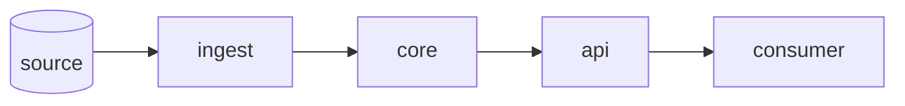

<!-- Current state only. Change it together with the ADR that changes it. -->

**Purpose:** one line.

| component | code | owns | talks to |
|---|---|---|---|
| ingest | `src/pkg/ingest/` | | |

**Key data shapes:** schema blocks, or links to them.

**Invariants:** things that must stay true.

**Decisions:** [adr/](adr/)
